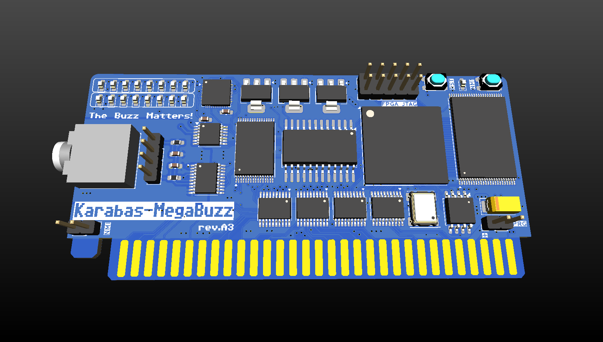
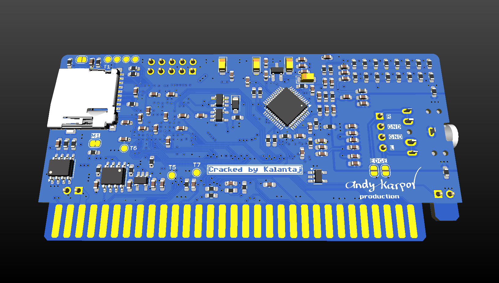
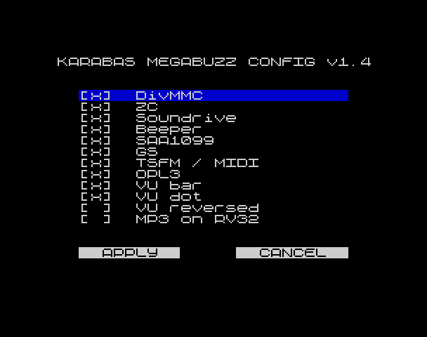

## Karabas-MegaBuzz

English | [Русский](README.ru.md)

Simple FPGA based sound card for ZX Spectrum (NemoBus). 
Inspired by a ZX-Multisound and karabas-opl3 soundcards :)

[](docs/karabas-megabuzz_revA3_top.png?raw=true)

[](docs/karabas-megabuzz_revA3_bottom.png?raw=true)

### Tech specs

* Turbosound FM
* General Sound 2 MB (1.5 MB on Rev.A1 while DivMMC is enabled)
* OPL3 sound by YMF-262-M
* MIDI by Dream SAM2695
* SAA1099
* Soundrive, Covox + Beeper
* MP3, OGG, WMA, AAC decoding by VS1053/VS1063 (Rev.A3)
* MP3 decoding in software on a RISC-V core inside the XC6SLX25, up to 320 kbps stereo
* 16-bit DAC PCM5102
* XC6SLX16 / XC6SLX25 FPGA
* SD Card by Z-Controller / DivMMC (since rev.A1)
* Low profile PCB: 92x44mm
* 5V only power required

### What each board can do

| | Rev.A | Rev.A1 | Rev.A2 | Rev.A3 |
| :--- | :--- | :--- | :--- | :--- |
| TS-FM, GS, OPL3, SAA, Soundrive, Covox, Beeper, MIDI | yes | yes | yes | yes |
| SD card (Z-Controller, DivMMC) | no | yes | yes | yes |
| Settings | DIP switches | DIP switches | configurator | configurator |
| RAM of DivMMC | - | shared with GS | own SRAM | own SRAM |
| MP3 | software, XC6SLX25 only | software, XC6SLX25 only | software, XC6SLX25 only | VS1053 chip; software as an option on XC6SLX25 |

### Getting started

1. Flash the card: see [the manual](HOWTO.en.md) and the [table below](#bitstreams--roms-to-flash-into-the-spi-flash-chip).
2. Prepare the SD card (Rev.A1 and newer):

   ```
   /SYS/               system files of esxDOS 0.8.9
   /BIN/               dot commands of esxDOS
   /BIN/BPLUGINS/mp3   MP3 plugin for the NMI browser, firmware/src/plugin/mp3
   ```

   The esxDOS ROM is built into the bitstream, the SD card needs the matching files from the esxDOS 0.8.9 distribution.
3. Power up the computer, then press RESET or NMI once. The card does not reset the host by itself, and this is what lets DivMMC take over.

### Playing MP3

In the NMI browser by Bob Fossil, with the plugin above, select an MP3 file. It can also play a whole directory. `Space` goes to the next track, `Q` leaves.

The software decoder and the chip work the same for players (registers `#F5`, `#F6`, `#FB`, see [PORTS.en.md](PORTS.en.md)). The software decoder implements the volume only, bass and treble are ignored, and it does not play free format MP3.

Which decoder is used:

* Rev.A, Rev.A1 and Rev.A2 on the XC6SLX25: always the software decoder. These boards have no VS1053 chip.
* Rev.A3 on the XC6SLX25: chosen by the `MP3 on RV32` option of the configurator, the VS1053 chip when it is off.
* Rev.A3 on the XC6SLX16: the VS1053 chip.
* The other boards on the XC6SLX16: no MP3, there is no room for the decoder.

### Settings

#### Rev.A and Rev.A1: DIP switches

A switch left open (or not soldered at all) means the device is enabled.

| Switch | Rev.A | Rev.A1 |
| :--- | :--- | :--- |
| SW1 | Soundrive + Covox + Beeper | DivMMC + Z-Controller |
| SW2 | SAA1099 | Soundrive + Covox + Beeper + SAA1099 |
| SW3 | General Sound | General Sound |
| SW4 | TurboSound FM + MIDI | TurboSound FM + MIDI |
| SW5 | OPL3 | OPL3 |

#### Rev.A2 and Rev.A3: configurator

Hold the RESET and NMI buttons on the card after it has started: the card replaces the ROM of the computer with the configurator.

[](docs/karabas-megabuzz_configurator.png?raw=true)

Use `Q`/`A` or the cursor keys to move, `Space` or `Enter` to change an option or press a button. `APPLY` saves the settings to the flash chip and reboots, `CANCEL` leaves them as they were.

| Option | Meaning |
| :--- | :--- |
| DivMMC | DivMMC with esxDOS |
| ZC | Z-Controller |
| Soundrive | Soundrive and Covox |
| Beeper | Beeper |
| SAA1099 | SAA1099 |
| GS | General Sound |
| TSFM / MIDI | TurboSound FM and MIDI |
| OPL3 | OPL3 |
| VU bar | VU meter as a bar |
| VU dot | VU meter peak dot |
| VU reversed | VU meter in the opposite direction |
| MP3 on RV32 | Rev.A3 on the XC6SLX25: use the software MP3 decoder instead of the VS1053 chip |

The same settings can be changed from a program, see [PORTS.en.md](PORTS.en.md).

### Changelog & current status [ERRATA](ERRATA.en.md)

* Rev.A - initial release

* Rev.A1 - intermediate revision

    * [x] Added SD card
    * [x] Changed OPL3 chip power to 3v3 rail, reset controlled by FPGA
    * [x] Added NMI button
    * [x] Added SD LED
    * [x] Added PSRAM chip
    * [x] Added new signals to grab and emit on nemobus (NMI, ROMCS)
    * [x] Added ability to pass sound out via nemobus slot

* Rev.A2 - current revision

    * [x] Removed DIP switches
    * [x] Added 128kB SRAM chip for DivMMC
    * [x] Added 8kb EEPROM chip to store configuration

* Rev.A3 - current dev version

    * [x] Added VS1053 IC


### How-to & Documentation

Please [read the manual](HOWTO.en.md) how to flash your card with alt tools, like Altera Usb Blaster + openocd.

Some links to the documentation files:

* revA: [Schematics](docs/karabas-megabuzz-revA.pdf), [interactive BOM](docs/karabas-megabuzz-revA-ibom.html)
* revA1: [Schematics](docs/karabas-megabuzz-revA1.pdf), [interactive BOM](docs/karabas-megabuzz-revA1-ibom.html)
* revA2: [Schematics](docs/karabas-megabuzz-revA2.pdf), [interactive BOM](docs/karabas-megabuzz-revA2-ibom.html)
* revA3: [Schematics](docs/karabas-megabuzz-revA3.pdf), [interactive BOM](docs/karabas-megabuzz-revA3-ibom.html)

### Bitstreams & ROMs to flash into the SPI flash chip

| Board Revision | FPGA XC6SLX16 | FPGA XC6SLX25 |
| :--- | :--- | :--- |
| **Rev.A** | • [(Bitstream)](firmware/src/syn/work16/karabas_megabuzz.bin)<br>• [(GS ROM)](firmware/src/rtl/sound/gs105b.rom)<br>• [(CFG)](firmware/src/syn/cfg1.rom) | • [(Bitstream)](firmware/src/syn/work25/karabas_megabuzz.bin)<br>• [(GS ROM)](firmware/src/rtl/sound/gs105b.rom)<br>• [(CFG)](firmware/src/syn/cfg1.rom)<br>• [(MP3 firmware)](firmware/src/syn/mp3dec.bin) |
| **Rev.A1** | • [(Bitstream)](firmware/src/syn/work16/karabas_megabuzz_a1.bin)<br>• [(GS ROM)](firmware/src/rtl/sound/gs105b.rom)<br>• [(CFG)](firmware/src/syn/cfg1.rom) | • [(Bitstream)](firmware/src/syn/work25/karabas_megabuzz_a1.bin)<br>• [(GS ROM)](firmware/src/rtl/sound/gs105b.rom)<br>• [(CFG)](firmware/src/syn/cfg1.rom)<br>• [(MP3 firmware)](firmware/src/syn/mp3dec.bin) |
| **Rev.A2** | • [(Bitstream)](firmware/src/syn/work16/karabas_megabuzz_a2.bin)<br>• [(GS ROM)](firmware/src/rtl/sound/gs105b.rom)<br>• [(CFG)](firmware/src/syn/cfg1.rom) | • [(Bitstream)](firmware/src/syn/work25/karabas_megabuzz_a2.bin)<br>• [(GS ROM)](firmware/src/rtl/sound/gs105b.rom)<br>• [(CFG)](firmware/src/syn/cfg1_a2_rv32.rom)<br>• [(MP3 firmware)](firmware/src/syn/mp3dec.bin) |
| **Rev.A3** | • [(Bitstream)](firmware/src/syn/work16/karabas_megabuzz_a3.bin)<br>• [(GS ROM)](firmware/src/rtl/sound/gs105b.rom)<br>• [(CFG)](firmware/src/syn/cfg1.rom) | • [(Bitstream)](firmware/src/syn/work25/karabas_megabuzz_a3.bin)<br>• [(GS ROM)](firmware/src/rtl/sound/gs105b.rom)<br>• [(CFG)](firmware/src/syn/cfg1.rom)<br>• [(MP3 firmware)](firmware/src/syn/mp3dec.bin) |


Flash layout: bitstream at `0x000000`, GS ROM at `0x100000`, MP3 firmware at `0x180000` (XC6SLX25 only), configuration at `0x1F0000`.

### Related projects

* Karabas-OPL3 - [link](https://github.com/andykarpov/karabas-opl3)
* BomgeMoon - [link](https://github.com/Kulicheg/BomgeMoon)
* ZX-Multisound - [link](https://github.com/UzixLS/zx-multisound)
* Turbo Sound FM - [link](http://www.nedopc.com/TURBOSOUND/ts-fm.php)
* ZXM-SoundCard - [link](http://micklab.ru/My%20Soundcard/ZXMSoundCard.htm)
* ZXM-GeneralSound - [link](http://micklab.ru/My%20Soundcard/ZXMGeneralSound.htm)
* NeoGS - [link](http://www.nedopc.com/gs/ngs.php)
