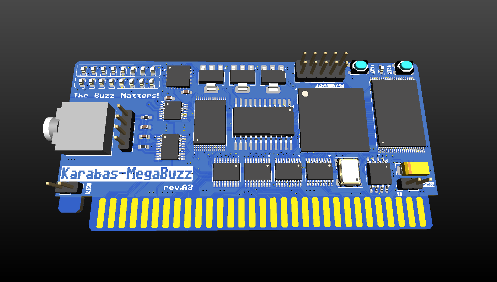
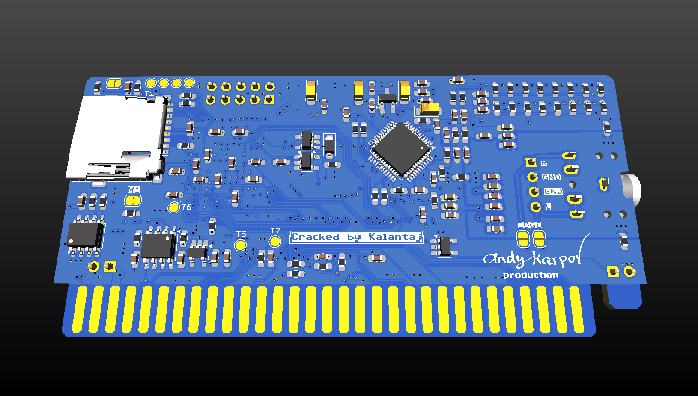
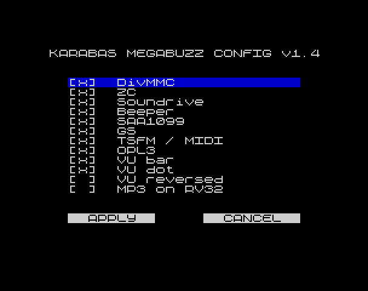

## Karabas-MegaBuzz

[English](README.md) | Русский

Простая звуковая карта на FPGA для ZX Spectrum (NemoBus).
Вдохновлена звуковыми картами ZX-Multisound и karabas-opl3 :)

[](docs/karabas-megabuzz_revA3_top.png?raw=true)

[](docs/karabas-megabuzz_revA3_bottom.png?raw=true)

### Характеристики

* Turbosound FM
* General Sound 2 МБ (1.5 МБ на Rev.A1 при включённом DivMMC)
* OPL3 на YMF-262-M
* MIDI на Dream SAM2695
* SAA1099
* Soundrive, Covox + Beeper
* Декодирование MP3, OGG, WMA, AAC на VS1053/VS1063 (Rev.A3)
* Программное декодирование MP3 на ядре RISC-V внутри XC6SLX25, до 320 кбит/с стерео
* 16-битный ЦАП PCM5102
* FPGA XC6SLX16 / XC6SLX25
* SD-карта через Z-Controller / DivMMC (начиная с rev.A1)
* Низкопрофильная плата: 92x44 мм
* Питание только 5 В

### Что умеет каждая плата

| | Rev.A | Rev.A1 | Rev.A2 | Rev.A3 |
| :--- | :--- | :--- | :--- | :--- |
| TS-FM, GS, OPL3, SAA, Soundrive, Covox, Beeper, MIDI | да | да | да | да |
| SD-карта (Z-Controller, DivMMC) | нет | да | да | да |
| Настройки | DIP-переключатели | DIP-переключатели | конфигуратор | конфигуратор |
| Память DivMMC | - | общая с GS | своя SRAM | своя SRAM |
| MP3 | программно, только XC6SLX25 | программно, только XC6SLX25 | программно, только XC6SLX25 | чип VS1053; программно как опция на XC6SLX25 |

### С чего начать

1. Прошейте плату: см. [инструкцию](HOWTO.md) и [таблицу ниже](#прошивки-и-пзу-для-spi-флешки).
2. Подготовьте SD-карту (Rev.A1 и новее):

   ```
   /SYS/               системные файлы esxDOS 0.8.9
   /BIN/               dot-команды esxDOS
   /BIN/BPLUGINS/mp3   плагин MP3 для NMI-браузера, firmware/src/plugin/mp3
   ```

   ПЗУ esxDOS встроена в битстрим, на SD-карте нужны соответствующие файлы из дистрибутива esxDOS 0.8.9.
3. Включите компьютер и один раз нажмите RESET или NMI. Плата сама хост не сбрасывает, и именно это нажатие позволяет DivMMC подхватиться.

### Воспроизведение MP3

В NMI-браузере от Bob Fossil с плагином из списка выше выберите MP3-файл. Можно проигрывать и всю директорию подряд. `Space` — следующий трек, `Q` — выход.

Для плееров программный декодер и чип работают одинаково (регистры `#F5`, `#F6`, `#FB`, см. [PORTS.md](PORTS.md)). Программный декодер поддерживает только громкость, бас и треб игнорируются, режим free format не воспроизводится.

Какой декодер используется:

* Rev.A, Rev.A1 и Rev.A2 на XC6SLX25: всегда программный декодер, чипа VS1053 на этих платах нет.
* Rev.A3 на XC6SLX25: выбирается опцией `MP3 on RV32` в конфигураторе, если она выключена — чип VS1053.
* Rev.A3 на XC6SLX16: чип VS1053.
* Остальные платы на XC6SLX16: MP3 нет, декодер там не помещается.

### Настройки

#### Rev.A и Rev.A1: DIP-переключатели

Разомкнутый (или вообще незапаянный) переключатель означает, что устройство включено.

| Переключатель | Rev.A | Rev.A1 |
| :--- | :--- | :--- |
| SW1 | Soundrive + Covox + Beeper | DivMMC + Z-Controller |
| SW2 | SAA1099 | Soundrive + Covox + Beeper + SAA1099 |
| SW3 | General Sound | General Sound |
| SW4 | TurboSound FM + MIDI | TurboSound FM + MIDI |
| SW5 | OPL3 | OPL3 |

#### Rev.A2 и Rev.A3: конфигуратор

Зажмите на плате кнопки RESET и NMI после её старта: вместо ПЗУ компьютера включится конфигуратор.

[](docs/karabas-megabuzz_configurator.png?raw=true)

Клавиши `Q`/`A` или курсор — перемещение, `Space` или `Enter` — изменить опцию или нажать кнопку. `APPLY` сохраняет настройки во флешку и перезагружает плату, `CANCEL` оставляет всё как было.

| Опция | Значение |
| :--- | :--- |
| DivMMC | DivMMC с esxDOS |
| ZC | Z-Controller |
| Soundrive | Soundrive и Covox |
| Beeper | Beeper |
| SAA1099 | SAA1099 |
| GS | General Sound |
| TSFM / MIDI | TurboSound FM и MIDI |
| OPL3 | OPL3 |
| VU bar | VU-метр в виде столбика |
| VU dot | Точка пика на VU-метре |
| VU reversed | VU-метр в обратную сторону |
| MP3 on RV32 | Rev.A3 на XC6SLX25: использовать программный декодер MP3 вместо чипа VS1053 |

Те же настройки можно менять из программы, см. [PORTS.md](PORTS.md).

### История изменений и текущее состояние [ERRATA](ERRATA.md)

* Rev.A — первый выпуск

* Rev.A1 — промежуточная ревизия

    * [x] Добавлена SD-карта
    * [x] Питание OPL3 переведено на 3.3 В, сброс управляется FPGA
    * [x] Добавлена кнопка NMI
    * [x] Добавлен светодиод SD
    * [x] Добавлена микросхема PSRAM
    * [x] Добавлены новые сигналы NemoBus (NMI, ROMCS)
    * [x] Добавлен вывод звука в слот NemoBus

* Rev.A2 — актуальная ревизия

    * [x] Убраны DIP-переключатели
    * [x] Добавлена SRAM на 128 КБ для DivMMC
    * [x] Добавлена EEPROM на 8 КБ для хранения настроек

* Rev.A3 — текущая версия в разработке

    * [x] Добавлена микросхема VS1053

### Инструкции и документация

[Читайте инструкцию](HOWTO.md) о том, как прошить плату альтернативными средствами, например через Altera USB Blaster и openocd.

Ссылки на документацию:

* revA: [Schematics](docs/karabas-megabuzz-revA.pdf), [interactive BOM](docs/karabas-megabuzz-revA-ibom.html)
* revA1: [Schematics](docs/karabas-megabuzz-revA1.pdf), [interactive BOM](docs/karabas-megabuzz-revA1-ibom.html)
* revA2: [Schematics](docs/karabas-megabuzz-revA2.pdf), [interactive BOM](docs/karabas-megabuzz-revA2-ibom.html)
* revA3: [Schematics](docs/karabas-megabuzz-revA3.pdf), [interactive BOM](docs/karabas-megabuzz-revA3-ibom.html)

### Прошивки и ПЗУ для SPI-флешки

| Ревизия платы | FPGA XC6SLX16 | FPGA XC6SLX25 |
| :--- | :--- | :--- |
| **Rev.A** | • [(Bitstream)](firmware/src/syn/work16/karabas_megabuzz.bin)<br>• [(GS ROM)](firmware/src/rtl/sound/gs105b.rom)<br>• [(CFG)](firmware/src/syn/cfg1.rom) | • [(Bitstream)](firmware/src/syn/work25/karabas_megabuzz.bin)<br>• [(GS ROM)](firmware/src/rtl/sound/gs105b.rom)<br>• [(CFG)](firmware/src/syn/cfg1.rom)<br>• [(MP3 firmware)](firmware/src/syn/mp3dec.bin) |
| **Rev.A1** | • [(Bitstream)](firmware/src/syn/work16/karabas_megabuzz_a1.bin)<br>• [(GS ROM)](firmware/src/rtl/sound/gs105b.rom)<br>• [(CFG)](firmware/src/syn/cfg1.rom) | • [(Bitstream)](firmware/src/syn/work25/karabas_megabuzz_a1.bin)<br>• [(GS ROM)](firmware/src/rtl/sound/gs105b.rom)<br>• [(CFG)](firmware/src/syn/cfg1.rom)<br>• [(MP3 firmware)](firmware/src/syn/mp3dec.bin) |
| **Rev.A2** | • [(Bitstream)](firmware/src/syn/work16/karabas_megabuzz_a2.bin)<br>• [(GS ROM)](firmware/src/rtl/sound/gs105b.rom)<br>• [(CFG)](firmware/src/syn/cfg1.rom) | • [(Bitstream)](firmware/src/syn/work25/karabas_megabuzz_a2.bin)<br>• [(GS ROM)](firmware/src/rtl/sound/gs105b.rom)<br>• [(CFG)](firmware/src/syn/cfg1_a2_rv32.rom)<br>• [(MP3 firmware)](firmware/src/syn/mp3dec.bin) |
| **Rev.A3** | • [(Bitstream)](firmware/src/syn/work16/karabas_megabuzz_a3.bin)<br>• [(GS ROM)](firmware/src/rtl/sound/gs105b.rom)<br>• [(CFG)](firmware/src/syn/cfg1.rom) | • [(Bitstream)](firmware/src/syn/work25/karabas_megabuzz_a3.bin)<br>• [(GS ROM)](firmware/src/rtl/sound/gs105b.rom)<br>• [(CFG)](firmware/src/syn/cfg1.rom)<br>• [(MP3 firmware)](firmware/src/syn/mp3dec.bin) |

Разметка флешки: битстрим с `0x000000`, ПЗУ GS с `0x100000`, прошивка MP3 с `0x180000` (только XC6SLX25), настройки с `0x1F0000`.

### Похожие проекты

* Karabas-OPL3 - [link](https://github.com/andykarpov/karabas-opl3)
* BomgeMoon - [link](https://github.com/Kulicheg/BomgeMoon)
* ZX-Multisound - [link](https://github.com/UzixLS/zx-multisound)
* Turbo Sound FM - [link](http://www.nedopc.com/TURBOSOUND/ts-fm.php)
* ZXM-SoundCard - [link](http://micklab.ru/My%20Soundcard/ZXMSoundCard.htm)
* ZXM-GeneralSound - [link](http://micklab.ru/My%20Soundcard/ZXMGeneralSound.htm)
* NeoGS - [link](http://www.nedopc.com/gs/ngs.php)
